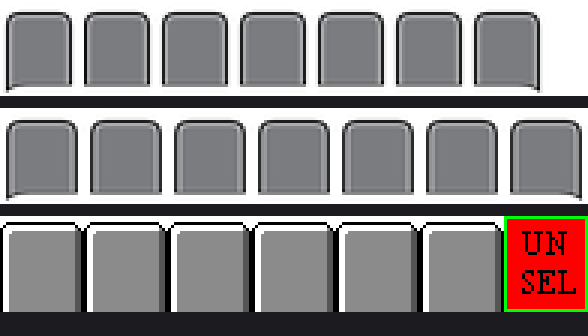

# CozyUI+ 低版本适配：技术方案与实测证据

> 英文版见 [`porting-notes.md`](porting-notes.md)。
>
> **结论已更新**：§9（单包通吃）与 §10（四个版本带）记录的是早期方案。最终发布改为
> **每个格式号一个包，共 11 个**，以零格式警告为目标；其中边界数据的推导过程仍然有效，
> 最终结论见 §12。

目标：把官方仅支持 **1.20 及以上**的 CozyUI+ 降到 **1.19 及以下**可用，
并且让"以后再来一遍"是可复现的，而不是手工改包。

---

## 1. 先定性：这是资源包，不是 mod

此处判断失误，后续工作量估算会相差一个数量级。

| 证据 | 结论 |
|---|---|
| Modrinth 项目 `cozyui-plus` 的 `project_type` = `resourcepack` | 资源包 |
| 官方仓库 `main` 分支只有 `README.md` / 4 个 LICENSE / `description_image/`（banner、gif、mp4）/ `SourceCode 源代码/`（`005.psd`、`icon.zip` 里是 `icon.psd`） | 仓库里只有**素材源文件**，没有代码 |
| 仓库内 `build.gradle` / `settings.gradle` / `src/` / `fabric.mod.json` **均不存在** | 不是 Fabric/Forge mod |
| 发布的包体 `CozyUI+ v1.10.zip` 内只有 `assets/**` + `pack.mcmeta` + `pack.png` + 说明/license | 纯资源包 |

所以适配工作 = **`pack.mcmeta` 的 `pack_format` + 资源路径是否对齐 + 贴图版式是否对位**，
完全不涉及 Java 工具链（不需要 JDK 17/21、不需要 Gradle Loom、不需要 Yarn 映射、
不需要能访问 `maven.fabricmc.net`）。

包体实测：891 个条目、807 个 png、51 个 `.mcmeta`（动画）、22 个 OptiGUI `.properties`、
5 个 json、2 个 ogg，`assets/minecraft/textures/` 下 525 张图。

---

## 2. 为什么"降级"这件事在 1.20 附近特别值钱

### 2.1 1.20.2 把整张 GUI 大图拆成了上千张小 sprite

资源包格式 **18（1.20.2）** 起，`gui/widgets.png`、`gui/icons.png`、`gui/bars.png` 这些
"一张图管一整套控件"的大图被拆成 `gui/sprites/**` 下的小图。实测：

| 路径 | 1.16.5 | 1.19.2 | 1.20.1 | 1.20.2 |
|---|:--:|:--:|:--:|:--:|
| `gui/widgets.png` | ✔ | ✔ | ✔ | **不存在** |
| `gui/icons.png` | ✔ | ✔ | ✔ | **不存在** |
| `gui/bars.png` | ✔ | ✔ | ✔ | **不存在** |
| `gui/sprites/hud/heart/full.png` | ✘ | ✘ | ✘ | ✔ |

上游为了同时支持 1.20~1.21 各个版本，**两套版式都带了**：76 张老版式覆盖贴图 +
421 张 sprite。对 1.20.1 而言那 421 张 sprite 全是死文件（实测：包里 891 个条目中
只有 79 个在 1.20.1 真正被读取）。

### 2.2 反过来，老版式大图在 1.16.5 ~ 1.20.1 之间几乎是冻结的

这是能低成本降级的**根本原因**。实测同一个路径的原版文件字节数：

| 路径 | 1.16.5 | 1.17.1 | 1.18.2 | 1.19.2 | 1.19.4 | 1.20.1 |
|---|--:|--:|--:|--:|--:|--:|
| `gui/widgets.png` | 15444 | 15444 | 15444 | 15444 | 15444 | 15444 |
| `gui/bars.png` | 1833 | 1833 | 1833 | 1833 | 1833 | 1833 |
| `gui/icons.png` | 7914 | 8082 | 8082 | 8081 | 8081 | 8081 |

`widgets.png` 跨 5 个大版本**一个字节都没变**——按钮、槽位、热键栏的版式完全一致。
所以上游照 1.20.1 画的那套老版式美术，天然就能落在 1.19.x / 1.18.x / 1.17.x 的正确位置上。

真正需要处理的，只剩少数几个"版式真的变过"的贴图。

---

## 3. 资源包格式号（决定 `pack_format`）

来源：[minecraft.wiki/w/Pack_format](https://minecraft.wiki/w/Pack_format) 的 **resource pack** 表
（注意：资源包格式号与数据包格式号**不是一套**，例如 1.19 是数据包 10 / 资源包 9）。

| MC 版本 | 资源包格式 | 相对 1.20.1 的版式变化（官方变更记录） |
|---|:--:|---|
| 1.20.2 – 1.20.4 | 18 – 22 | sprite 化、`supported_formats`、overlays |
| 1.20 – 1.20.1 | 15 | `minecraft.png` / `invite_icon.png` sprite 布局；`legacy_unicode` provider 移除 |
| 1.19.4 | 13 | 附魔光效拆两张；**旧锻造台贴图改名 `legacy_smithing.png`，`smithing.png` 改成 1.20 新版式** |
| 1.19.3 | 12 | **`tabs.png` 变窄 2px 并加入第 7 个标签页**；新增 `atlases/` 目录 |
| 1.19 – 1.19.2 | 9 | 允许 `pack.mcmeta` 里写 `filter` |
| 1.18 – 1.18.2 | 8 | **`inventory.png` 多出一个"细版效果列表"图块** |
| 1.17 – 1.17.1 | 7 | 游戏模式选择器槽位 25px → 26px |
| 1.16.2 – 1.16.5 | 6 | MC-197275 墙体改动 |
| 1.15 – 1.16.1 | 5 | 下界更新，界面无结构性变化 |
| 1.13 – 1.14.4 | 4 | **扁平化：`textures/items/`→`item/`、`blocks/`→`block/`、`*.lang`→`*.json`**；村民交易改分页 |
| 1.11 – 1.12.2 | 3 | 加入进度（advancements）界面、配方书 |
| 1.9 – 1.10.2 | 2 | 双持、`widgets.png` 重排 |
| 1.8 – 1.8.9 | 1 | 基底世代（容器面板版式一直沿用到 1.20） |

---

## 4. 实测：每个版本到底要改几张图

方法：把包里每张 `assets/minecraft/textures/**` 的图，与**目标版本原版客户端 jar 里同路径的图**
比 `alpha` 掩膜（= 版式轮廓，忽略全透明像素里的 RGB 垃圾数据——老版本 PNG 里这类噪声很多，
直接比字节会得到 30% 的假差异）。

| 目标版本 | 包在该版本真正生效的贴图 | 版式逐像素相同 | **版式有差异** |
|---|--:|--:|--:|
| 1.19.4 | 76 | 76 | **0** |
| 1.19.3 | 57 | 57 | **0** |
| 1.19 – 1.19.2 | 56 | 53 | **3** |
| 1.18 – 1.18.2 | 54 | 51 | **3** |
| 1.17 – 1.17.1 | 54 | 50 | **4** |
| 1.16.2 – 1.16.5 | 54 | 47 | **7** |

（列数从 76 降到 57 的原因：`1.19.4` 才出现的 `checkmark` / `slider` / `info_icon` /
`unseen_notification` / 顶底分隔线 / 14 张 `item/empty_slot_*`（锻造模板槽位图标）
在更老版本里根本不存在，包覆盖了它们也是白覆盖。）

另外，每个 ≤1.20.1 的版本带都能安全剪掉 **421 张 `gui/sprites/**`**（1.20.2+ 才读取）。
注意「原版没有」≠「死文件」：包里 19 张 `textures/font/*.png`、`lang/zh_cn.json`、
22 个 `optifine/**.properties` 及其贴图、2 个 `.ogg` 在原版 jar 里同样不存在，
但它们是包自己新增、被自身 json 引用的资源，剪了就坏功能。构建器只剪白名单里的那棵树。

**结论：1.19.4 / 1.19.3 只改 `pack_format` 就能直接用，一张图都不用动。**
这也意味着"1.19 适配"的真正工作量集中在 ≤1.19.2。

### 4.1 需要重新对位的贴图清单（含实测形状差）

| 贴图 | 首次出问题的版本 | 形状差异像素 | 官方原因 | 处理方式 |
|---|---|--:|---|---|
| `creative_inventory/tabs.png` | 1.19.3 | 2012 | 列宽 28→26px、多一页 | **列级重映射**（26→28 拉伸，1:1 映射 7 列） |
| `container/inventory.png` | 1.18 | 1122 | 多出"细版效果列表"图块 | 单元格回退 |
| `toasts.png` | ≤1.19.2 | 2 / 197(1.16.5) | toast 布局微调 | 单元格回退 |
| `icons.png` | 1.18 | 2 / 114(1.16.5) | 少量 HUD 图标改动 | 单元格回退 |
| `chat_tags.png` | ≤1.19.2 | 33 | 1.19 新增聊天标签 | 单元格回退 |
| `gamemode_switcher.png` | 1.16.5 | 181 | 槽位 25→26px | 单元格回退 |
| `shulker_box.png` | 1.16.5 | 6 | — | 单元格回退 |
| `recipe_button.png` | 1.16.5 | 31 | 按钮改版 | 单元格回退 |

另外有两类是**版式相同但画的"内容"语义变了**，形状检测抓不到，需要人工判断（见 §7）：

* `container/smithing.png`：1.19.4 起该路径就已经是 **1.20 新版式**（3 槽锻造模板），
  但 ≤1.19.2 用的是**旧版 2 槽锻造台**。好消息是实测两边面板**轮廓逐像素相同**
  （形状差 = 0，仅 2253 像素颜色差），所以不会错位，最多多出一块装饰格。
* `recipe_book.png` / `recipe_button.png`：≤1.19.2 有 102 / 198 像素颜色差，属美术细节。

---

## 5. 构建器怎么做到的（`tools/build.py`）

不是"照版本改路径"这种表驱动，而是**拿原版客户端 jar 当几何基准**逐图判定：

```
对包里每张 assets/minecraft/textures/**.png：
  目标版本原版有这张图吗？没有 → 只有在 PRUNABLE_PREFIXES（gui/sprites/）里才剪掉
  有 → 比较「本包美术所针对的版式代际(1.20.1)」与「目标版本」的原版 alpha 掩膜
        掩膜一致 → 版式没变，本包美术直接沿用（95% 的图走这里）
        掩膜不一致 → 按 16x16 单元格逐格判定：
              该格掩膜一致 → 把本包美术（4x 分辨率）搬过去
              该格掩膜不一致 → 退回目标版本原版贴图（放大到本包分辨率）
                             并记入 build-report.json 的 art_todo
```

三处细节值得单独说明：

**(a) 分辨率是 4×，不是 1×。** 包里所有 GUI 图都是原版的 4 倍（`widgets.png` 1024² vs 原版 256²）。
构建器先求整数倍率再处理，倍率不整齐的图（如 `panorama_*.png` 原版基准是 1×1 占位图）
一律原样跳过，避免把图缩坏。

**(b) 剪枝用白名单，不做"原版没有就删"。** 这是过程中踩到的真坑：
包里 `textures/font/*.png`（19 张字体位图）、`lang/zh_cn.json`、`optifine/**`（22 个
OptiGUI 配置及其贴图）、`sounds/05/*.ogg` 在**原版 jar 里当然都没有**——它们是包自己
新增、被自己 json 引用着的资源。按"原版没有即删"会把字体、OptiGUI 彩色潜影盒、按钮音效
一起删掉。所以只剪 `assets/minecraft/textures/gui/sprites/` 这一棵明确版本门控的树。

**(c) `tabs.png` 用列级重映射而不是单元格回退。** 实测三者的列结构：

| | 列区内容 | 尾部独立元素 |
|---|---|---|
| 本包 | x 0..181 = **7 列 × 26px** | x 232..255（24px） |
| 1.20.1 原版 | x 0..207 = 8 列 × 26px | x 232..255 |
| 1.19.2 原版 | x 0..195 = **7 列 × 28px** | x 232..255 |

三边尾部那块 24px 元素位置一致，所以只对列区做 26→28 的 1:1 映射，尾部原样搬。
若退回通用的单元格回退，7 列 × 26 与 7 列 × 28 的累计错位会让后面几页的图标整块偏移
（第 6 页偏 12px），比"略变形"糟糕得多。

---

## 6. 自检（`tools/validate.py`，不需要进游戏）

对 `dist/` 每个 zip 逐项检查，**15/15 通过**（11 个版本带 + 2 个单包通吃 + 2 个无字体版）：

| 检查 | 说明 |
|---|---|
| zip 完整性 + `pack.mcmeta` 可解析 | `pack_format` 与目标版本表逐一对齐 |
| `pack.png` 存在 | 资源包列表里要有图标 |
| `.png.mcmeta` 配对 | 动画元数据悬空会持续刷错误日志 |
| **字体引用完整性** | 2 个字体 json 共 38 条 `"file"` 引用，必须都解析到真实贴图（本包或原版） |
| **OptiGUI 引用完整性** | 21 条 `texture=` 必须指向真实 png（彩色潜影盒/发射器靠它） |
| **覆盖路径真实性** | `textures/gui|item` 下每个文件是否真存在于目标原版（不存在=白带的重量，会列出） |
| `sounds.json` 引用 | 每条 `name` 能找到 ogg |
| PNG 可解码 | 逐张 `Image.load()` |
| **单包版声明完整** | `supported_formats`（1.20.2+）与 `min_format`/`max_format`（1.21.9+）必须同时写对，否则高版本会以为只支持 format 6 而拒绝加载 |

另外 `build.py` 自带列重映射的结构自检：7 个目标列带的纵向覆盖率必须 ≥0.85
（实测 0.855 ~ 0.914），任何一列没铺到就判失败。

---

## 7. 剩余的美术任务（老实说清楚）

自动管线能保证**几何不错位**，但保证不了**风格统一**。以下 4 项需要人或绘图工具介入：

1. **`tabs.png` 的 26→28 拉伸**（仅 ≤1.19.2）：几何对得上，圆角页会略扁 7.7%。
   想完美就在 Aseprite 里按"7 列 × 28px"重画一遍。
2. **`smithing.png`**（仅 ≤1.19.2）：上游画的是 1.20 的 3 槽锻造模板界面，
   1.19.2 是旧版 2 槽。要么按旧版重画，要么接受多一块装饰格。
3. **单元格回退处的原版灰块**：版式变过的那一小块会退回原版贴图，例如 1.16.5 的
   `gamemode_switcher`（游戏模式切换器）、`inventory` 底部效果列表区、`icons.png` 少量 HUD 图标。
   精确坐标都在 `work/build-report.json` 的 `art_todo`（含 x/y/w/h）。
4. **`font/uniform.json`**：上游把整个 uniform 字体替换成了 emoji/UI 位图，开「强制 Unicode」
   后非拉丁字形可能消失。这是上游自身行为；规避方式是 `--no-fonts` 版
   （11.4 MB，不含 26 MB 字体）。

---

## 8. 尚未验证的部分（不要当成已完成）

* **没有进游戏截图**。本环境无法启动 Minecraft，所以"视觉正确"目前只有
  ①原版 jar 逐图像素比对 ②列覆盖结构自检 ③资源引用完整性 三重静态证据，**没有真机证据**。
  首次使用请按 README 的冒烟清单过一遍，尤其是创造模式标签页。
* **第三方 mod 命名空间未校验**（JEI/REI/苹果皮/Jade/Xaero/MiniHUD/ReplayMod/OptiGUI 等 18 个）。
  它们由各自 mod 的版本决定，只在对应 mod 版本匹配时生效。
* **1.16.5 / 1.17.1 只做了 1 个版本带**（1.16.2–1.16.5 共用格式 6，1.17–1.17.1 共用格式 7），
  未逐个补丁版本验证。

---

## 9. 单包通吃：一个 zip 覆盖 1.16.2 ~ 1.21.11

上游就是一个 zip 通吃 1.20 ~ 1.21.11 的，所以"能不能再往下压成一个包"值得认真回答。

### 9.1 上游单包为什么能成立

因为 1.20 → 1.21 之间的所有版式差异都是**加法**：新增 sprite、新增路径。
老版式大图和新版式 sprite 各占一条路径，同时塞进包里，游戏只读认识的那套，
另一套被忽略——**同一条路径从来不需要两种版式**，所以永远不打架。

### 9.2 压到 1.20 以下，加法变成了互斥

用 12 个原版 jar（1.16.5 ~ 1.21.11）对包里全部 66 张图集大图做「同路径版式代际」判定，
**真正互斥（同一条路径必须同时满足两种版式）的有 8 张**：

| 贴图 | 互斥的版本组 | 说明 |
|---|---|---|
| `creative_inventory/tabs.png` | ≤1.19.2(7×28) vs 1.19.3–1.20.1(8×26) | **唯一影响面大的** |
| `chat_tags.png` | 1.19.2 vs 1.19.3–1.20.1 | 33 像素 |
| `toasts.png` | 1.16.5 / 1.17.1–1.19.2 / 1.19.3–1.20.1 | 2~197 像素 |
| `icons.png` | 1.16.5 / 1.17.1–1.18.2 / 1.19.2–1.20.1 | 2~114 像素 |
| `container/inventory.png` | ≤1.17.1 vs 1.18.2–1.20.1 | 1122 像素（细版效果列表图块） |
| `container/gamemode_switcher.png` | 1.16.5 vs 1.17.1+ | 181 像素 |
| `container/shulker_box.png` | 1.16.5 vs 1.17.1+ | 6 像素 |
| `recipe_button.png` | 1.16.5 vs 1.17.1+ | 31 像素 |

其余 58 张（含所有 `container/*.png` 底板）**没有互斥**：包留的是带槽位凹陷的 1.20.1 版，
在 1.20.2+ 上凹陷会被叠画的 sprite 盖住，不会重复；反过来留无凹陷版，1.20.1 就会出现空洞。
所以"上游的单美术选择"本身就是兼容的。

### 9.3 关于 tabs.png 的两个关键事实

1. **1.20.2+ 根本不读它**——创造模式页签改用 `gui/sprites/container/creative_inventory/tab_*.png`。
   所以这个互斥的影响面**只到 1.20.1**，压不到新版式那半边。
2. **页签"图标"来自独立文件**（`tab_items.png` / `tab_inventory.png` / `tab_item_search.png`），
   对不齐的只有底板接缝与圆角，**不会出现"图标跑到别的页上"**。

把上游的 8×26 图按 1.19.2 的 28px 步长模拟采样一遍，实际观感是这样（三段分别为：
上游图被 1.19.2 采样的样子 / 26→28 重映射后 / 1.19.2 原版）：



差异是"接缝处多一条竖线 + 最后一页窄一点"，属于能看出来但不影响可用性。

### 9.4 于是出两个通吃包

| 产物 | 页签美术 | 完美 | 有接缝错位 |
|---|---|---|---|
| `CozyUI+_v1.10_all-versions.zip` | 上游 8×26 | 1.19.3+（含 1.20.2~1.21.11） | 1.16.2 ~ 1.19.2 |
| `CozyUI+_v1.10_all-versions-legacy-tabs.zip` | 26→28 重映射 | 1.16.2 ~ 1.19.2 | 1.19.3 ~ 1.20.1 |

两者都**不影响 1.20.2+**（读 sprite），都保留全部 891 个条目（41 MB，sprite 必须留着）。

### 9.5 `pack_format` 只能是一个数，这是单包通吃的固有代价

`pack_format` 只有一个整数，而各版本期望的值不同（6/7/8/9/12/13/15…），
所以**必然有一部分版本会看到"版本不匹配"提示**。通吃包取区间最低值 **6**：

| 版本 | 读什么 | 结果 |
|---|---|---|
| 1.16.2 ~ 1.16.5 | `pack_format`=6 | ✅ 零提示 |
| 1.17 ~ 1.20.1 | `pack_format`（6 < 期望值） | ⚠️ 显示"为旧版本制作"，仍可正常启用 |
| 1.20.2 ~ 1.21.11 | `supported_formats=[6,9999]` | ✅ 零提示 |
| 1.21.9+ | `min_format`/`max_format` | ✅ 零提示 |

顺带说一句：**上游原包在 1.16 ~ 1.20.1 上会被判"为更新版本制作"**，因为它的
`pack_format` 是 15，而 `supported_formats` 要到 1.20.2 才被读取。所以"直接拿上游 zip 去 1.19 用"
是能加载的，只是会带提示、也不算干净——通吃包解决的正是这件事。

### 9.6 单包通吃要付的代价（逐图实测）

对 8 张互斥贴图逐张算 IoU（1.0 = 完全对位），对比"通吃包"与"逐版本包"：

| 贴图 | 版本 | 通吃包 | 逐版本包 |
|---|---|--:|--:|
| `recipe_button.png` | 1.16.5 | 0.418 | **0.895** |
| `gamemode_switcher.png` | 1.16.5 | 0.709 | **0.822** |
| `container/inventory.png` | 1.16.5 | 0.939 | **0.963** |
| `chat_tags.png` | 1.19.2 | 0.250 | **1.000** |
| `creative_inventory/tabs.png` | 1.19.2 | 0.688（modern） / **0.759**（legacy） | **0.759** |

**结论：如果你只服务某一个版本区间，逐版本包更好**（低端这几张图是真的对不齐，
`recipe_button` 会明显错位）；**如果你想像原作者那样一个包发出去图省事、且主要用户在新版本**，
用 `all-versions`；**如果你的用户主要在 1.16~1.19.2**，用 `all-versions-legacy-tabs`。

高版本那半边不需要担心：通吃包覆盖了 1.21.11 原版 445 张 sprite 中的 **413 张（92.8%）**，
1.20.2 覆盖 367/403（91.1%），都是上游自带的部分，这次没有改动。


---

## 10. 一路压到 1.8：1.8 ~ 1.16.1 的四个版本带

### 10.1 意外的好消息：容器面板从 1.8 就没再改过

把 1.8.9 的原版 jar 拉下来，和 1.20.1 逐图比 alpha 掩膜：

| 贴图 | 1.8.9 vs 1.20.1 掩膜 IoU |
|---|--:|
| `container/generic_54.png` | 0.988 |
| `container/brewing_stand.png` | 0.986 |
| `container/horse.png` | 0.980 |
| `container/enchanting_table.png` | 0.945 |
| `container/beacon.png` | 0.880 |
| `container/inventory.png` | 0.869 |
| `container/hopper.png` | 0.794 |
| `container/crafting_table.png` | 0.756 |
| `container/anvil.png` | 0.712 |
| `container/furnace.png` | 0.689 |
| `gui/widgets.png` | **0.341** |
| `gui/icons.png` | **0.560** |

**容器面板是这十多年里最稳的一类贴图**——背包底板 `176×166` 的布局从 1.8 到 1.20 基本没动，
所以「cozy 风的容器」这一段能几乎无损地搬到 1.8。而 `widgets.png`（按钮/滑条/输入框）和
`icons.png`（HUD）才是被反复重排过的。

### 10.2 踩到的第一个坑：用什么当"能不能搬"的判据

第一版我用 **包美术 vs 目标原版** 的 alpha IoU 当闸门（低于 0.6 就整张丢弃），结果把
`widgets.png` 在 1.13–1.16.1 上也误杀了——因为**这是资源包，本身就重绘过轮廓**，
"重绘风格距离"天然就有 0.3~0.4，拿它当错位判据必然误判。

正确判据是**相对退化比**：

```
ratio = IoU(包美术, 目标原版) / IoU(包美术, 它原本针对的 1.20.1 原版)
```

- `ratio ≈ 1` → 版式没变，重绘风格距离保持，可以搬
- `ratio` 明显 < 1 → 目标版式真的不一样

实测：`widgets.png` 在 1.13/1.14/1.15/1.16.1 的 ratio 都是 **1.0**（1.12 的也是！），
而在 **1.8.9 / 1.9 / 1.11 是 0.35~0.37**。也就是说按钮版式在 **1.13 才定格**，
比直觉（以为 1.9 就改了）更晚——这条只能靠实测，不能靠猜。

另外配一条硬规则：**包美术与目标原版不是整数倍缩放 = 不在同一张栅格上**，直接丢。
`container/villager.png` 就是这么被抓出来的：包里是 `2048×1024`（1.14+ 的分页式交易界面），
而 1.8.9 是 `256×256`，硬塞进去只会显示一小块。它的 IoU 反而很高（两边都是大片不透明面板），
只看 IoU 是抓不到的。

### 10.3 1.8–1.12 改走 strict：只发目标版本真实存在的路径

1.8.9 的原版只有 28 条路径和包里同名。如果沿用"只剪 `gui/sprites/`"的策略，包里会有
**800 多个 1.8 根本不读的文件**（sprite、1.13+ 的 `item/empty_slot_*`、`font/*.json`…），
37 MB 里九成是死重量。所以这四个带改用 **strict**：只保留目标版本原版真实存在的路径。

结果：1.8.9 包 **32 个文件 / 4.9 MB**，1.9–1.10.2 是 34 个 / 5.0 MB，1.11–1.12.2 是 40 个 / 5.5 MB。
1.13 起恢复常规策略（因为 1.13+ 的字体是 `font/default.json`，包自己新增的
`textures/font/*.png` 必须留着，strict 会把它们剪掉导致字形全丢）。

### 10.4 顺便确认了一件事：标签栏的列结构在 1.8.9 ~ 1.19.2 完全相同

逐列跑一次"内容游程"：

| 版本 | 列区内容 | 尾部独立块 |
|---|---|---|
| 1.8.9 / 1.10.2 / 1.12.2 / 1.14.4 / 1.16.5 / 1.19.2 | x 0..195（196px） | x 232..255（24px） |
| 1.19.3 / 1.20.1 | x 0..207（208px） | x 232..255（24px） |

也就是说 §5(c) 的 **7 列 × 28px 规则对整个 1.8–1.19.2 都成立**，不用为每个带单独调参；
只有 1.19.3 起才换成 8 列 × 26px。

### 10.5 两个功能是真的搬不过去

* **RGB 循环**：上游是用 `gui/sprites/hud/experience_bar_progress.png.mcmeta` 与
  `hotbar_selection.png.mcmeta`（`frametime: 100` 的慢速动画）实现的，**这是 1.20.2 才有的
  sprite 动画**。≤1.20.1 想重现，必须把整张 `bars.png` / `widgets.png` 做成动画条
  （因为老版式下 mcmeta 只能动画整张图），体积和工时都不小，本次没做。
* **控件动画**：上游 README 明写"需要 ≥1.21"。

所以 1.8–1.20.1 的观感是"静态的 cozy"，而不是上游在 1.21 上的效果。这点**必须在商店页面写清楚**，
否则会被当成 bug 反馈。

### 10.6 各版本带的实测结果

| 版本带 | 格式 | 文件数 | 体积 | 版式修补 | 吻合度闸门丢弃 |
|---|:--:|--:|--:|--:|--:|
| 1.8 – 1.8.9 | 1 | 32 | 4.9 MB | 7 | 2（`widgets.png` 0.35、`villager.png` 栅格不符） |
| 1.9 – 1.10.2 | 2 | 34 | 5.0 MB | 6 | 2（同上） |
| 1.11 – 1.12.2 | 3 | 40 | 5.5 MB | 6 | 2（同上） |
| 1.13 – 1.14.4 | 4 | 419 | 37.3 MB | 7 | 1（`checkbox.png` 栅格不符） |
| 1.15 – 1.16.1 | 5 | 420 | 37.3 MB | 7 | 0 |
| 1.16.2 – 1.16.5 | 6 | 420 | 37.3 MB | 7 | — |
| 1.17 – 1.17.1 | 7 | 420 | 37.3 MB | 4 | — |
| 1.18 – 1.18.2 | 8 | 420 | 37.3 MB | 3 | — |
| 1.19 – 1.19.2 | 9 | 420 | 37.3 MB | 3 | — |
| 1.19.3 | 12 | 420 | 37.2 MB | 0 | — |
| 1.19.4 | 13 | 420 | 37.2 MB | 0 | — |


---

## 11. 后续可以继续做的

0. **补 1.8–1.12 的 `widgets.png`**：手写一张「1.13+ 控件矩形 → 1.8–1.12 控件矩形」的映射表，
   两代 `widgets.png` 都是 256×256，逐矩形搬一次就能把按钮/滑条/输入框也带下去，
   这是那四个版本带目前最大的空缺。
1. **用 sprite 反推老版式大图**：包里那 421 张 sprite 是 1.20.2+ 的高质量拆分图，
   可以把 `widgets.png` / `icons.png` 里版式变过的区域用 sprite 重新拼出来，
   替掉"退回原版灰块"的部分，风格会统一得多。
2. **补 1.15.2 / 1.12.2 世代**：格式 5 / 4，GUI 版式差异更大（`options_background`、
   旧版 `widgets.png` 尺寸不同），需要各自的规则。
3. **CI**：`build.py` + `validate.py` 已经是纯脚本，可以挂 GitHub Actions，
   上游发新版就自动重出全部版本带。
4. **进游戏自动化冒烟**：用 headless 客户端 + 截图比对，把 §8 的第 1 条补上。

---

## 附录：如何重新获取输入

```bash
# 上游包（Modrinth v1.10，release）
curl -L -o upstream-packs/cozy-v1.10-full.zip \
  "https://cdn.modrinth.com/data/G5rf50k2/versions/Sh3uNYag/%C2%A7cCozyUI%C2%A7b%2B%20%C2%A77v1.10%20%C2%A70.zip"

# 原版客户端 jar（几何基准）：从 version_manifest 取每个版本的 client 下载地址
curl -s https://piston-meta.mojang.com/mc/game/version_manifest_v2.json
```

若 GitHub 直连不通，仓库源码可用镜像取：
`https://ghfast.top/https://github.com/Fogg05/CozyUI-Plus/archive/refs/heads/main.zip`
（内容只有 README、素材 psd 和宣传图，没有包体）。


---

## 12. RGB 渐变：把 1.20.2 的 sprite 动画搬回 1.8

### 12.1 上游到底怎么做的

不是着色器，也不是 OptiFine，是 **1.20.2 才引入的 sprite 动画**：

| sprite | 尺寸 | 帧数 | 帧高 | frametime | 一轮 |
|---|--:|--:|--:|--:|--:|
| `hud/experience_bar_progress` | 728×160 | 8 | 20 | 100 tick | 40 s |
| `hud/hotbar_selection` | 96×736 | 8 | 92 | 100 tick | 40 s |
| `hud/jump_bar_progress` | 728×160 | 8 | 20 | 100 tick | 40 s |

三张都带 `interpolate: true`，所以帧间是平滑插值而不是硬跳。

从 `experience_bar_progress` 的 8 帧里取有颜色像素（S>60）的**色相中位数**：

```
11, 26, 50, 93, 124, 146, 174, 205     (0-255)
橙 → 黄 → 黄绿 → 绿 → 青 → 蓝 → 紫 → 品红
```

### 12.2 为什么不能照搬

sprite 系统 1.20.2 才有。≤1.20.1 的 GUI 是**整张图集 + 固定 uv 矩形**：
经验条是 `icons.png` 里的一块，选中框是 `widgets.png` 里的一块。
而 mcmeta 的 `animation` 只能作用于**整张纹理**，不能只动画一个矩形。

唯一可行的移植：**把整张图集做成 N 帧动画**，每帧只改那一个矩形，其余像素逐字节相同。
视觉上就等价于"只有那一块在缓慢变色"。

### 12.3 坐标：十一代一个像素都没挪

| 元素 | 图集 | 1x 矩形 | 实测证据 |
|---|---|---|---|
| 经验条前景 | `icons.png` | `(0,69,182,5)` | 1.8.9–1.19.4 全部 906 px、饱和 0.59、均价 `#436830` |
| 快捷栏选中框 | `widgets.png` | `(0,0,24,24)` | 1.8.9–1.19.4 全部 576 px、纯灰 `#3D3D30` |
| Boss 血条 | `bars.png` | `y81..118` 八对 | 纯黑 + 代码染色，**不能动** |

> 一个曾经的误判：以为 1.13+ 把经验条挪进了 `bars.png`。实际扫描后确认
> `bars.png` 里只有 Boss 血条，**经验条从 1.8 到 1.20.1 一直在 `icons.png`**。

### 12.4 着色方式

- **经验条**（`hue`）：原图本来就是绿色，只换 H 通道、保留 S/V → 明暗、描边、圆角全保留。
- **选中框**（`tint`）：原图纯灰（S=0），只换 H 看不出颜色，所以同时把 S 顶到约 110。

### 12.5 帧率冲突：为什么放弃按钮脉冲

`widget/button_highlighted` 是 16 帧 × `frametime: 1`（0.05 秒/帧）的呼吸脉冲。
它和选中框**共用同一张 widgets.png**，而一张图只能有一个 `animation` 定义。

统一到 0.05s → 选中框需要 8 × 100 = 800 帧 → 不可行。

取舍：保 RGB（上游 README 的招牌特性），放弃按钮脉冲（上游自己也标注需要 ≥1.21）。

### 12.6 代价与关闭方式

| 图集 | 帧尺寸 | 帧数 | 显存 |
|---|--:|--:|--:|
| `icons.png` | 1024×1024 | 8 | 32 MB |
| `widgets.png` | 1024×1024 | 8 | 32 MB |

低配机器删掉 `assets/minecraft/textures/gui/icons.png.mcmeta` 和
`widgets.png.mcmeta` 即可关掉动画，纹理退回单帧，**不会错位**。

### 12.7 1.8–1.12 的残缺

那三段的 `widgets.png` 因为版式差 37% 已整张回退原版，所以**没有选中框渐变**；
经验条在 `icons.png` 里且保留成功，所以**经验条渐变正常**。
